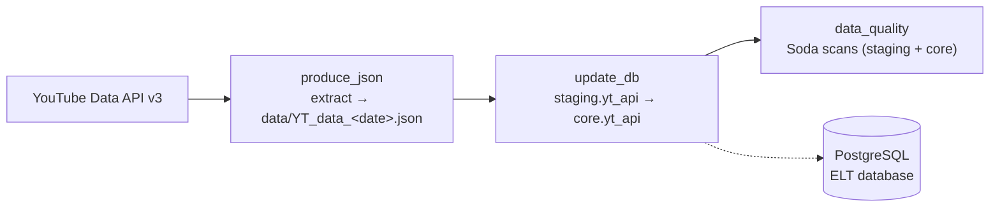

# YT_ELT — YouTube Channel ELT Pipeline

An end-to-end **ELT pipeline** that extracts video statistics for a YouTube channel from the **YouTube Data API v3**, loads them into **PostgreSQL** (a `staging` layer and a transformed `core` layer), and validates the data with **Soda**. It is orchestrated by **Apache Airflow** and runs in **Docker Compose**.


---

## Table of Contents

- [Architecture](#architecture)
- [Tech Stack](#tech-stack)
- [Project Structure](#project-structure)
- [The DAGs](#the-dags)
- [Data Model](#data-model)
- [Data Quality](#data-quality)
- [Getting Started](#getting-started)
- [Running the Pipeline](#running-the-pipeline)
- [Testing](#testing)
- [CI/CD](#cicd)
- [Troubleshooting](#troubleshooting)

---

## Architecture



The three DAGs are chained with `TriggerDagRunOperator`, so only `produce_json` has a schedule (**daily at 14:00, Asia/Jerusalem**). The others are triggered when the previous DAG succeeds.

All services run in Docker:

| Service             | Purpose                                                                 |
|---------------------|-------------------------------------------------------------------------|
| `postgres`          | One Postgres 13 instance holding 3 databases: Airflow metadata, Celery result backend, and the ELT warehouse |
| `redis`             | Celery message broker                                                   |
| `airflow-init`      | Migrates the metadata DB and creates the admin user                    |
| `airflow-webserver` | Airflow UI on [http://localhost:8080](http://localhost:8080)            |
| `airflow-scheduler` | Schedules DAG runs                                                      |
| `airflow-worker`    | Celery worker that executes tasks                                       |

---

## Tech Stack

- **Orchestration:** Apache Airflow 2.9.2 (CeleryExecutor)
- **Language:** Python 3.10
- **Storage:** PostgreSQL 13
- **Broker:** Redis 7.2
- **Data quality:** Soda Core (`soda-core-postgres`)
- **Testing:** pytest
- **Containerization:** Docker & Docker Compose; custom Airflow image published to Docker Hub
- **CI/CD:** GitHub Actions

---

## Project Structure

```
YT_ELT/
├── dags/
│   ├── main.py                       # Defines the 3 DAGs and their dependencies
│   ├── api/
│   │   └── video_stats.py            # Extract: YouTube API calls + save to JSON
│   ├── datawarehouse/
│   │   ├── dwh.py                    # staging_table / core_table tasks
│   │   ├── data_loading.py           # Reads the day's JSON file
│   │   ├── data_modification.py      # insert / update / delete rows
│   │   ├── data_transformation.py    # Duration parsing + Video_Type
│   │   └── data_utils.py             # Connection, schema & table creation
│   └── dataquality/
│       └── soda.py                   # BashOperator running `soda scan`
├── include/soda/
│   ├── configuration.yml             # Soda data source (Postgres)
│   └── checks.yml                    # Data quality checks
├── docker/postgres/
│   └── init-multiple-databases.sh    # Creates metadata / celery / ELT databases
├── tests/
│   ├── conftest.py                   # pytest fixtures
│   ├── unit_test.py                  # Variables, connection, DAG integrity
│   └── integration_test.py           # Real YouTube API + real Postgres
├── data/                             # Daily JSON extracts (one sample is committed)
├── .github/workflows/
│   └── ci-cd_yt-elt.yaml             # Build/push image + tests
├── docker-compose.yaml
├── Dockerfile                        # Custom Airflow image
└── requirements.txt
```

---

## The DAGs

### 1. `produce_json` — Extract
Scheduled daily at `0 14 * * *` (Asia/Jerusalem).

| Task | Description |
|------|-------------|
| `get_playlist_id` | Resolves the channel handle to its **uploads** playlist ID |
| `get_video_ids` | Pages through the playlist (50 per page) to collect every video ID |
| `extract_video_data` | Fetches `snippet`, `contentDetails` and `statistics` in batches of 50 |
| `save_to_json` | Writes `data/YT_data_<YYYY-MM-DD>.json` |
| `trigger_update_db` | Triggers the `update_db` DAG |

Sample record:
```json
{
    "video_id": "v9QtM6qnG50",
    "title": "I Built A City To Save Kids From Illegal Labor",
    "publishedAt": "2026-09-19T16:00:01Z",
    "duration": "PT19M3S",
    "viewCount": "5132606",
    "likeCount": "431107",
    "commentCount": "29793"
}
```

### 2. `update_db` — Load & Transform

| Task | Description |
|------|-------------|
| `update_staging` | Loads today's JSON into `staging.yt_api` |
| `update_core` | Reads `staging.yt_api`, transforms each row, loads into `core.yt_api` |
| `trigger_data_quality` | Triggers the `data_quality` DAG |

Each run **fully syncs** the target table. Existing `Video_ID`s are updated, new ones are inserted, and IDs that are no longer in the source are deleted.

### 3. `data_quality` — Validate

| Task | Description |
|------|-------------|
| `soda_test_staging` | Runs Soda checks against `staging.yt_api` |
| `soda_test_core` | Runs Soda checks against `core.yt_api` |

---

## Data Model

Both layers use a table named `yt_api` with quoted, mixed-case column names.

| Column | `staging.yt_api` | `core.yt_api` |
|--------|------------------|---------------|
| `Video_ID` | `VARCHAR(11)` PK | `VARCHAR(11)` PK |
| `Video_Title` | `TEXT` | `TEXT` |
| `Upload_Date` | `TIMESTAMP` | `TIMESTAMP` |
| `Duration` | `VARCHAR(20)` (ISO-8601, e.g. `PT19M3S`) | `TIME` (e.g. `00:19:03`) |
| `Video_Type` | — | `VARCHAR(10)`: `Short` (≤ 60s) or `Normal` |
| `Video_Views` | `INT` | `INT` |
| `Likes_Count` | `INT` | `INT` |
| `Comments_Count` | `INT` | `INT` |

**Transformations (staging → core):**
- The ISO-8601 duration (`PT1H2M3S`) is parsed and stored as `TIME`.
- `Video_Type` is derived from the duration: `Short` if ≤ 60 seconds, otherwise `Normal`.

---

## Data Quality

Defined in [`include/soda/checks.yml`](include/soda/checks.yml) and run against both schemas:

- No missing `Video_ID`
- No duplicate `Video_ID`
- `Likes_Count` is never greater than `Video_Views`
- `Comments_Count` is never greater than `Video_Views`

---

## Getting Started

### Prerequisites

- [Docker Desktop](https://www.docker.com/products/docker-desktop/) (at least 4 GB RAM and 2 CPUs allocated)
- A **YouTube Data API v3** key from the [Google Cloud Console](https://console.cloud.google.com/apis/library/youtube.googleapis.com)
- The handle of the YouTube channel you want to track (e.g. `MrBeast`)

### 1. Clone the repository

```bash
git clone https://github.com/OrlyBarr/YT_ELT.git
cd YT_ELT
```

### 2. Create a `.env` file

Create `.env` in the project root. It is git-ignored, so never commit it.

```dotenv
# Docker Hub image
DOCKERHUB_NAMESPACE=<your-dockerhub-user>
DOCKERHUB_REPOSITORY=<your-image-repo>
IMAGE_TAG=latest

# Postgres connection
POSTGRES_CONN_USERNAME=postgres
POSTGRES_CONN_PASSWORD=<password>
POSTGRES_CONN_HOST=postgres
POSTGRES_CONN_PORT=5432

# Airflow metadata database
METADATA_DATABASE_NAME=airflow_metadata_db
METADATA_DATABASE_USERNAME=<user>
METADATA_DATABASE_PASSWORD=<password>

# Celery result backend database
CELERY_BACKEND_NAME=celery_results_db
CELERY_BACKEND_USERNAME=<user>
CELERY_BACKEND_PASSWORD=<password>

# ELT warehouse database
ELT_DATABASE_NAME=elt_db
ELT_DATABASE_USERNAME=<user>
ELT_DATABASE_PASSWORD=<password>

# Airflow
AIRFLOW_UID=50000
AIRFLOW_WWW_USER_USERNAME=airflow
AIRFLOW_WWW_USER_PASSWORD=<password>
FERNET_KEY=<fernet-key>

# YouTube
API_KEY=<youtube-api-key>
CHANNEL_HANDLE=<channel-handle>
```

Generate a Fernet key with:
```bash
python -c "from cryptography.fernet import Fernet; print(Fernet.generate_key().decode())"
```

> **How config reaches Airflow:** `docker-compose.yaml` maps these values to `AIRFLOW_VAR_API_KEY`, `AIRFLOW_VAR_CHANNEL_HANDLE` and `AIRFLOW_CONN_POSTGRES_DB_YT_ELT`. They are read as Airflow Variables/Connections from the environment, so they **won't appear in the Airflow UI** but `Variable.get()` still works.

### 3. Build or pull the Airflow image

The compose file uses `${DOCKERHUB_NAMESPACE}/${DOCKERHUB_REPOSITORY}:latest`. Either pull it from Docker Hub or build it locally:

```bash
docker build -t <your-dockerhub-user>/<your-image-repo>:latest .
```

### 4. Start the stack

```bash
docker compose up -d
```

Open the Airflow UI at **[http://localhost:8080](http://localhost:8080)** and log in with `AIRFLOW_WWW_USER_USERNAME` / `AIRFLOW_WWW_USER_PASSWORD`.

To stop it:
```bash
docker compose down        # stop containers
docker compose down -v     # also wipe the Postgres volume (re-runs DB init script)
```

---

## Running the Pipeline

1. In the Airflow UI, **unpause** all three DAGs: `produce_json`, `update_db` and `data_quality`. New DAGs start paused.
2. Trigger `produce_json` manually, or wait for the daily 14:00 run.
3. `update_db` and `data_quality` run automatically in sequence.

Query the results from your host (Postgres is exposed on port **5433**):

```bash
psql -h localhost -p 5433 -U <ELT_DATABASE_USERNAME> -d <ELT_DATABASE_NAME>
```
```sql
SELECT "Video_Type", COUNT(*), SUM("Video_Views")
FROM core.yt_api
GROUP BY "Video_Type";
```

Run a Soda scan by hand:
```bash
docker exec -it airflow-worker soda scan -d pg_datasource \
  -c /opt/airflow/include/soda/configuration.yml \
  -v SCHEMA=core /opt/airflow/include/soda/checks.yml
```

---

## Testing

The tests run inside the worker container (`tests/` is mounted at `/opt/airflow/tests`):

```bash
docker exec -it airflow-worker pytest tests/                                  # all tests
docker exec -it airflow-worker pytest tests/unit_test.py                      # unit tests only
docker exec -it airflow-worker pytest tests/unit_test.py::test_dags_integrity # a single test
```

| File | What it covers |
|------|----------------|
| `unit_test.py` | Mocked Airflow Variables and Connection, plus **DAG integrity**: no import errors, exactly 3 DAGs, and task counts of 5 / 3 / 2 |
| `integration_test.py` | A real call to the YouTube API (expects HTTP 200) and a real `SELECT 1` on the ELT database |

> If you add or remove tasks, update the expected task counts in `test_dags_integrity`.

---

## CI/CD

The GitHub Actions workflow is [`.github/workflows/ci-cd_yt-elt.yaml`](.github/workflows/ci-cd_yt-elt.yaml). It runs on pushes to `main` and `feature/*`, and on pull requests to `main`.

1. **build-and-push-image**: when the Dockerfile or `requirements.txt` changes, it builds the custom Airflow image and pushes it to Docker Hub tagged `latest` and `<commit-sha>`.
2. **unit-and-integration-and-e2e-tests**: when `dags/`, `include/` or `docker-compose.yaml` changes, it runs the test suite against the stack.

Required repository settings:
- **Secrets:** database credentials, `API_KEY`, `FERNET_KEY`, `AIRFLOW_WWW_USER_*`, `DOCKERHUB_PASSWORD`
- **Variables:** `DOCKERHUB_NAMESPACE`, `DOCKERHUB_REPOSITORY`, `DOCKERHUB_USERNAME`, `AIRFLOW_UID`, `CHANNEL_HANDLE`

> In `docker-compose.yaml`, the `env_file: .env` lines are marked *"SWITCH THIS OFF/ON WHEN USING GITHUB ACTIONS"*. Toggle them depending on whether you run locally or in CI.

---

## Troubleshooting

| Problem | Cause / Fix |
|---------|-------------|
| DAGs fail to import / `KeyError: Variable API_KEY does not exist` | `video_stats.py` reads `API_KEY` and `CHANNEL_HANDLE` at import time. Make sure both are set in `.env`. |
| `update_db` fails with `FileNotFoundError` | It reads `data/YT_data_<today>.json`, so `produce_json` must have run **today** first. |
| Port 5432 already in use | The compose file maps Postgres to host port **5433** to avoid a local Postgres install. |
| Databases missing after changing `.env` | The DB init script only runs on the first volume creation. Run `docker compose down -v` and start again. |
| `pull access denied` for the Airflow image | Build the image locally (step 3) or check `DOCKERHUB_NAMESPACE`/`DOCKERHUB_REPOSITORY`. |

---

## Author

**Orly Barr** — [GitHub @OrlyBarr](https://github.com/OrlyBarr)
